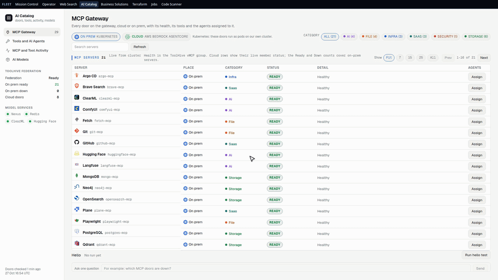
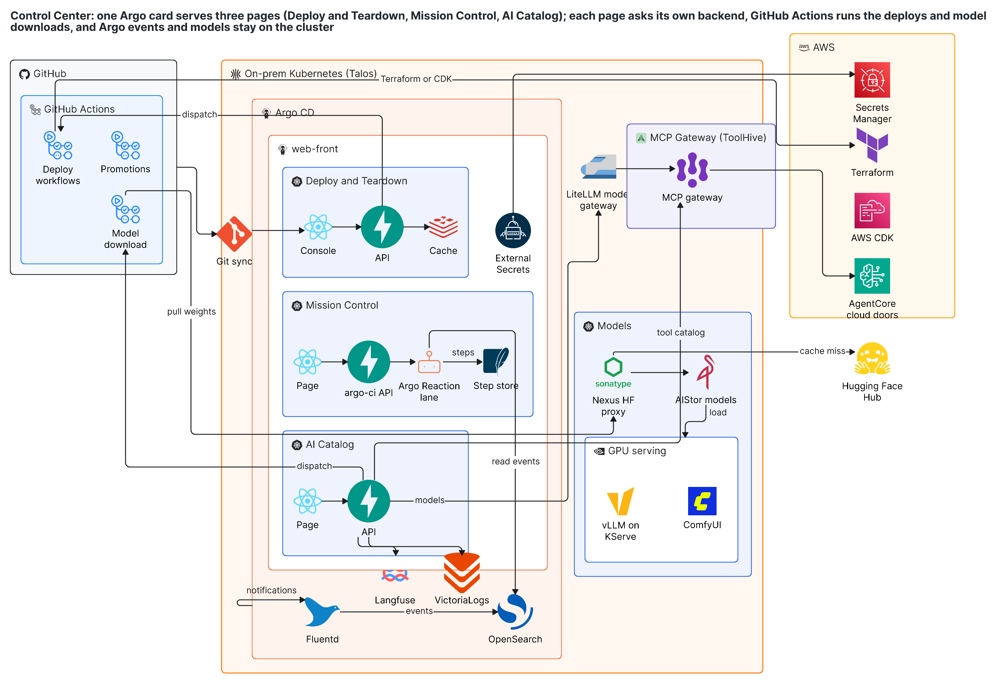

# Citadel AI

## Executive summary

Citadel AI runs a self-hosted AI platform day to day from two pages, and nothing risky happens on its own: every deploy is a tracked pipeline run, a teardown needs the word DESTROY typed first, and a project goes public only after a security check passes, with only its README, diagram, demo and license published.

- **AI Catalog** opens on the MCP Gateway: one  [Model Context Protocol](https://modelcontextprotocol.io) gateway on  [ToolHive](https://github.com/stacklok/toolhive) fronts every tool server the agents can call, on premises and in the cloud, and the page lists each once with its live status (Ready, Down, Needs a key). Its Tools and AI Agents page runs the hosted  [LangChain](https://python.langchain.com) tools and shows each call's timing and last error from  [Langfuse](https://langfuse.com) traces, next to the activity and models. Models are found on  [Hugging Face](https://huggingface.co), license access is checked, and each download lands in private storage and is served on the cluster GPU with  [vLLM](https://github.com/vllm-project/vllm) and  [ComfyUI](https://www.comfy.org).
- **Deploy and Teardown** lists every  [Terraform](https://developer.hashicorp.com/terraform) and  [AWS CDK](https://aws.amazon.com/cdk/) project from one registry that declares its deploy type, folder and region, so nobody types a path. Typing filters the list, and one click ships or removes one or many projects, following each run to its result and log on  [GitHub Actions](https://docs.github.com/actions) self-hosted runners.

## In action

**Click through the AI Catalog.** The MCP Gateway, the tools and AI agents, the activity panels and the models.

All clips are recorded on demo data.

## Architecture

Citadel AI is one web deployment on a self-hosted Kubernetes cluster, kept in step with git by  [Argo CD](https://argo-cd.readthedocs.io), which also deploys the  [LangGraph](https://langchain-ai.github.io/langgraph/) and  [LangChain](https://python.langchain.com) agents and the MCP tools the AI Catalog lists, with two pages over their own backends:

- **Web UI.** The two  [React](https://vite.dev) pages and their  [FastAPI](https://fastapi.tiangolo.com) backends ship together to Kubernetes through  [Argo CD](https://argo-cd.readthedocs.io), alongside the  [LangGraph](https://langchain-ai.github.io/langgraph/) and  [LangChain](https://python.langchain.com) agents and the MCP tools the AI Catalog lists.
- **Data pipeline.**  [GitHub Actions](https://docs.github.com/actions) self-hosted runners run the deploys and model downloads.
- **AI.**  [LangGraph](https://langchain-ai.github.io/langgraph/) and  [LangChain](https://python.langchain.com) run the agents and the hosted tools, the  [ToolHive](https://github.com/stacklok/toolhive) MCP gateway fronts every tool server,  [Langfuse](https://langfuse.com) traces show each call's timing and last error,  [Hugging Face](https://huggingface.co) is where models are found, and  [vLLM](https://github.com/vllm-project/vllm) and  [ComfyUI](https://www.comfy.org) serve them on the cluster GPU.
- **Deploy and infrastructure.**  [Terraform](https://developer.hashicorp.com/terraform) and  [AWS CDK](https://aws.amazon.com/cdk/) projects ship from one registry, and  [Argo CD](https://argo-cd.readthedocs.io) keeps the cluster in step with git and also delivers the  [LangGraph](https://langchain-ai.github.io/langgraph/) and [LangChain](https://python.langchain.com) agents and the MCP tools the AI Catalog lists.
- **Credentials.** Every key comes from a password manager at run time; none is in the code or the images.

## License

PolyForm Noncommercial 1.0.0 with a required notice from Haya Tech LLC. Noncommercial use is free; any commercial use, including resale, hosting for others, or a paid product, needs a written license from Haya Tech LLC first. See [LICENSE](LICENSE).
